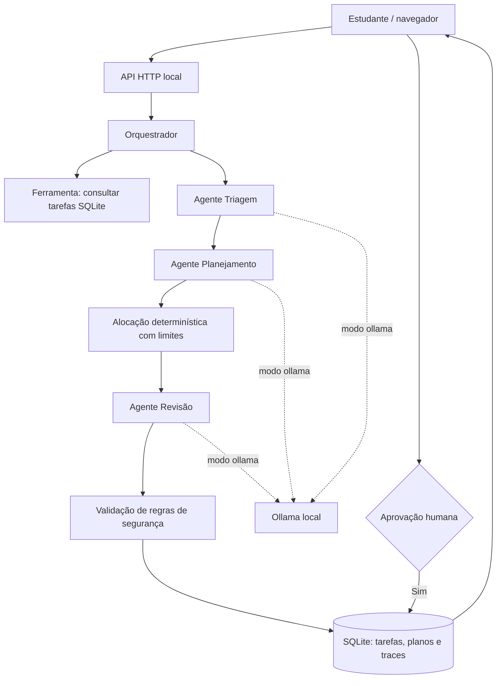

# EstudaAgentes — planejador acadêmico multiagente

**Projeto acadêmico de Técnicas Avançadas de Desenvolvimento de Software (TADS/UFMS).** MVP para organizar tarefas de estudo com triagem, planejamento, revisão, trilhas de execução e aprovação humana.

> **Transparência importante:** o modo `demo` funciona totalmente offline e é **determinístico**, sem modelo de IA. Para executar agentes apoiados em modelo de linguagem use `ollama` com um modelo local. O projeto demonstra uma arquitetura orientada a agentes, mas **não** usa decisões de LLM no modo demo.

## Problema

Estudantes precisam lidar com tarefas, prazos, estimativas imperfeitas e disponibilidade limitada. Uma lista simples não decide como organizar esforço diante de prioridades concorrentes. O sistema oferece uma proposta de planejamento verificável, deixando decisões irreversíveis sob controle humano.

## Executar (Python 3.10+; sem pip)

```bash
python -m src.server
```

Abra **http://127.0.0.1:8000**. Clique em **Carregar exemplo**, selecione `demo` e em **Gerar proposta de plano**. Veja agenda, pendências, revisão e trace; clique em **Aprovar plano proposto**.

### Opcional: agentes com IA local (Ollama)

1. Instale o Ollama usando as instruções oficiais do projeto.
2. No terminal execute `ollama pull llama3.2:3b` e mantenha o serviço Ollama em execução.
3. Inicie `python -m src.server` e selecione **Agentes com modelo Ollama local**.
4. Se necessário, defina `OLLAMA_MODEL` ou `OLLAMA_URL` (apenas localhost; padrão `http://127.0.0.1:11434`).

O modo Ollama precisa de RAM e processamento suficientes; a disponibilidade e qualidade variam conforme a máquina. **Não exige chave de API ou serviço em nuvem.** Em caso de erro no modelo, o sistema retorna erro explícito (não mascara como decisão de IA).

## Arquitetura



- **Orquestrador** (`run_workflow`): controla sequência e condição de término, proíbe execução sem tarefas e persiste resultado/traces.
- **Triagem** (`prioritize_agent`): recebe tarefas abertas e prazos; em modo LLM decide uma **ordem de IDs**, validada contra o catálogo; no modo demo utiliza ordenação fixa. Não pode editar o banco.
- **Planejamento** (`planning_agent`): recebe tarefas ordenadas e capacidade; o algoritmo determinístico `allocate` decide sessões admissíveis; o LLM decide **dicas de execução**, sem permissão de modificar a agenda.
- **Revisão** (`review_agent`): recebe plano e catálogo; regras verificam capacidade, prazos, IDs e tempo; o LLM pode apontar **riscos qualitativos**, sem substituir a validação formal.
- **Humano** (`approve_plan`): recebe a proposta e decide registrar aprovação. Aprovação **não envia eventos para calendário**, não altera tarefas e não executa ações externas.

### Por que agentes e não só workflow fixo?

A triagem pode variar com o contexto dos prazos, dificuldade, urgência e prioridade informados. Com LLM, o agente de triagem interpreta combinações de fatores; planejamento comunica dicas e revisão identifica riscos textuais. A estrutura, contratos, orçamento de minutos, persistência e aprovação **continuam determinísticos**. O valor do LLM é **limitado neste MVP**: ele ordena tarefas e produz orientações; não tem tool calling autônomo, memória semântica nem liberdade de buscar fontes externas. Isso é uma delimitação técnica, não uma capacidade implícita.

## Contratos, ferramentas, memória e guardrails

| Componente | Entrada | Decisão / saída | Acesso permitido |
|---|---|---|---|
| Triagem | Tarefas consultadas (máx. 25), data atual | Ordem + justificativa | Consulta somente leitura, Ollama local opcional |
| Planejamento | Ordem, duração, horizonte, horas/dia | Agenda segura + dicas | Alocador, Ollama local opcional |
| Revisão | Agenda, catálogo, limite diário | Violação, riscos, estado | Validador, Ollama local opcional |
| Orquestração | Parâmetros e saídas | Persistir proposta e trace | SQLite |
| Humano | Proposta | Aprovar ou não | Endpoint de aprovação |

**Guardrails:** entradas validadas; limites de 1–8 h/dia, 1–14 dias, até 25 tarefas por plano; sessões de até 60 minutos por tarefa/dia; prazos respeitados; resultados do modelo limitados/validados; sem execução de código pelo modelo; modelo só localhost; HTTP apenas em `127.0.0.1`; JSON até 10 KB; nenhuma alteração externa automática. O histórico dos planos fica no SQLite e o trace associa operações ao ID do plano.

**Riscos/limitações:** plano não considera horários do dia, feriados, dependências entre tarefas ou preferência pessoal; estimativas são fornecidas pelo estudante; alocação gulosa pode não encontrar a melhor solução global; dias corridos, não dias úteis; modelo local pode produzir conteúdo inadequado ou falhar; ausência de autenticação porque o servidor é apenas local. Não exponha este MVP na internet.

## Testes e avaliação

```bash
python -m unittest discover -s tests -v
```

Cenários automatizados: cadastro; rejeição de entradas inválidas; fluxo de ponta a ponta; aprovação única; capacidade insuficiente; exclusão de tarefas concluídas; IDs falsos retornados pelo modelo; detecção de violação de revisão; carga de demonstração idempotente.

**Critérios verificáveis:** (1) nenhum total diário excede horas disponíveis; (2) nenhuma sessão ocorre após o prazo; (3) IDs inválidos do modelo são recusados; (4) tarefas não são alteradas ao gerar proposta; (5) aprovação exige clique do usuário; (6) trace tem etapas de triagem, planejamento, revisão e orquestração. O modo LLM requer teste manual adicional com Ollama.

## API local

| Método | Rota | Função |
|---|---|---|
| GET | `/health` | Saúde |
| GET | `/api/tasks` | Listar tarefas |
| POST | `/api/tasks` | Criar tarefa |
| POST | `/api/tasks/{id}/done` | Concluir/reabrir (`{"done":true}`) |
| POST | `/api/demo` | Semear tarefas de exemplo (somente se lista vazia) |
| POST | `/api/plans` | Gerar plano (`{"hours_per_day":2,"days":7,"mode":"demo"}`) |
| GET | `/api/plans/{id}` | Recuperar proposta e trace |
| POST | `/api/plans/{id}/approve` | Registrar aprovação humana |

## Estrutura

```text
src/core.py             # Persistência, contratos, agentes, ferramentas, regras
src/server.py           # HTTP e rotas
web/index.html          # Interface visual
web/app.js              # Requisições e renderização sem HTML injetável
 tests/test_core.py     # Testes unitários e integrados
 docs/                  # Proposta, decisões e roteiro
```

## GitHub

O `.gitignore` impede o commit do SQLite local. Com Git instalado:

```bash
git init
git add .
git commit -m "feat: MVP de planejamento orientado a agentes"
# Crie um repositório vazio no GitHub e use a URL fornecida pela plataforma:
git remote add origin URL_DO_SEU_REPOSITORIO
git branch -M main
git push -u origin main
```

Consulte `DECISOES_E_EXPLICACOES.txt` e `docs/ROTEIRO_APRESENTACAO.md` antes de apresentar.


### Atualização: formato das respostas do Ollama

As chamadas agora solicitam **JSON estruturado com esquema** para cada agente,
reduzindo falhas como `Dicas inválidas.`. Por compatibilidade, os campos `tips`
e `risks` também aceitam uma frase única em vez de lista e a convertem para lista.
Respostas que não cumprem os contratos continuam sendo rejeitadas, sem alterar
o plano ou os dados. Essa correção não substitui a instalação de Ollama e do modelo.

Após atualizar os arquivos, **pare e reinicie** `python -m src.server` para
carregar a nova versão do backend.
